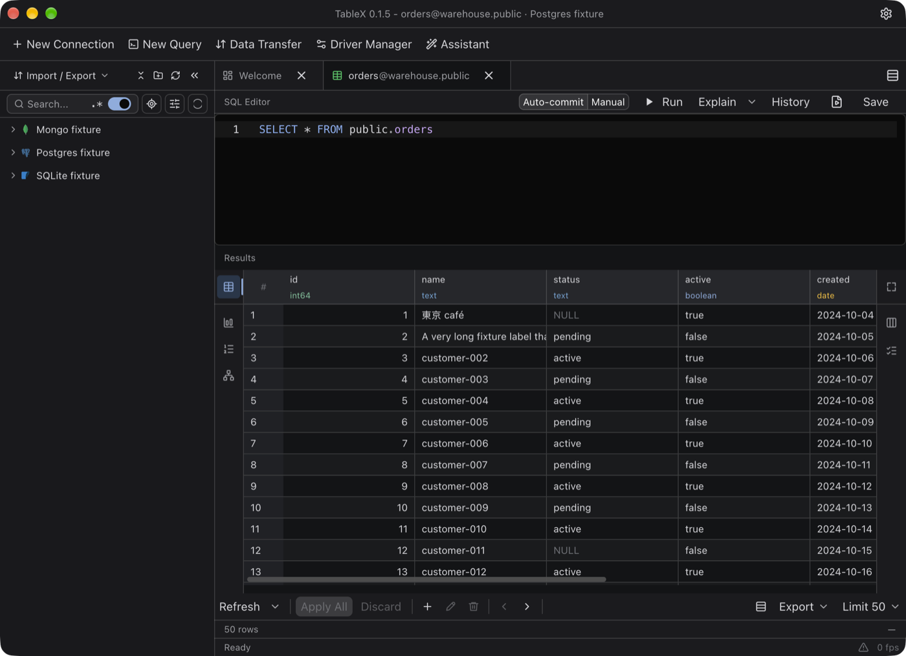
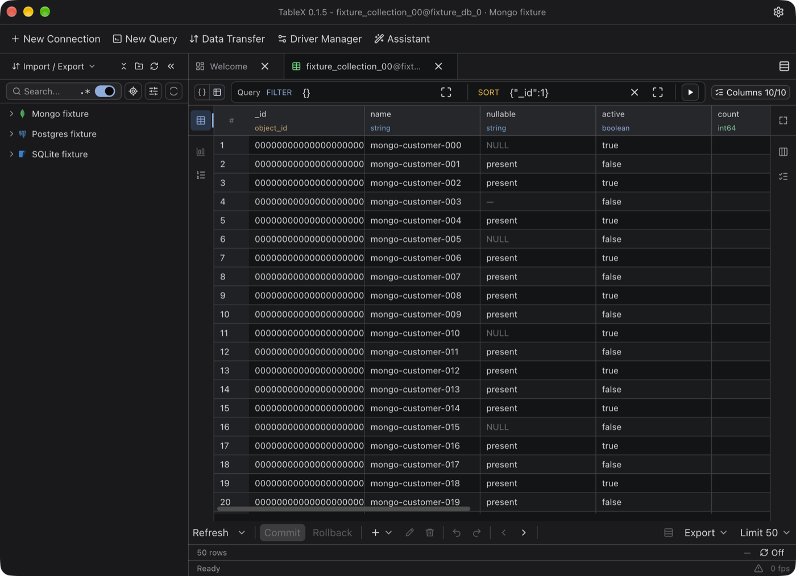
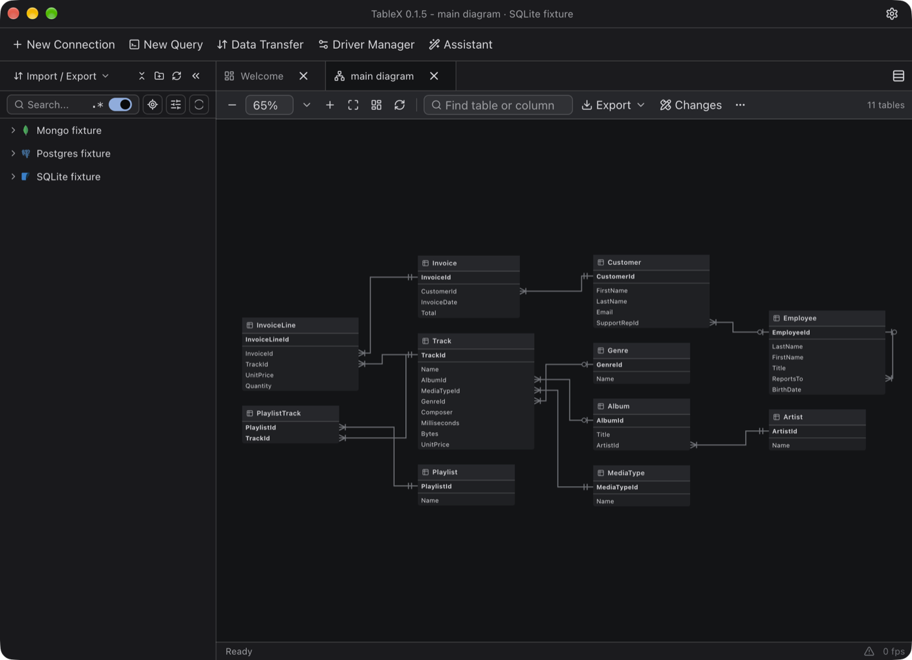
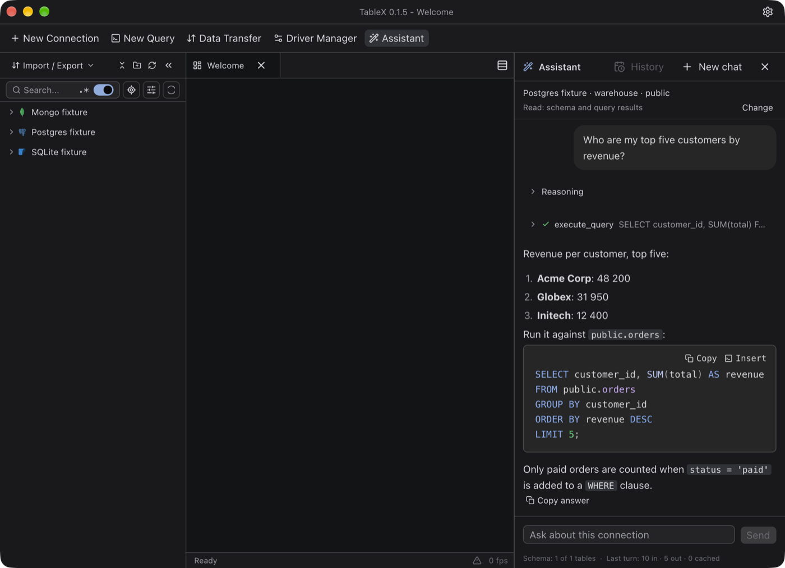
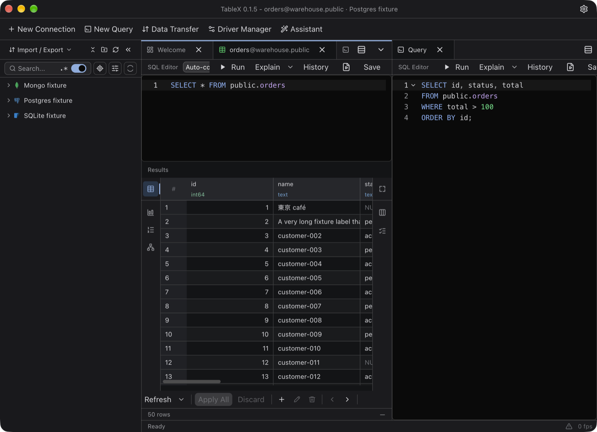

# TableX

A performance-first database client written in Rust with [GPUI](https://www.gpui.rs/).

- One native app aimed at macOS, Linux and Windows. It is developed and tested on macOS; the Linux and Windows builds are wired into CI but are not proven yet.
- Database support comes from driver plugins that the app downloads, verifies and loads at run time.
- Results travel as Apache Arrow from the driver to a virtualized grid.



## Databases

PostgreSQL, MySQL, MariaDB, SQLite, MongoDB, Redis and ClickHouse. Each is a separate driver, installed from **Driver Manager** inside the app.

## Features

- Connection tree with folders, search, SSH tunnels and import from other clients.
- Data grid with in-place editing, staged changes, filters, cell and row detail panes, copy and export.
- SQL and MongoDB editors with completion, query history and saved scripts.
- Tabs, split panes with drag and drop, a command palette, table and database diagrams.
- An AI assistant (Anthropic, OpenAI, OpenAI-compatible servers, Ollama) that reads the schema and runs queries with the access you give each connection; every statement that changes data asks first.
- `tablex-mcp`, a standalone MCP server over your saved connections, installed from Driver Manager → Tools. On macOS, run `tablex-mcp --authorize-keychain` once (or use Allow Keychain access there) so it can read saved passwords without prompting, and again after an update.

## Screenshots

<table>
  <tr>
    <td></td>
    <td></td>
  </tr>
  <tr>
    <td align="center">MongoDB documents in the same grid</td>
    <td align="center">Database diagram</td>
  </tr>
  <tr>
    <td></td>
    <td></td>
  </tr>
  <tr>
    <td align="center">AI assistant that reads the schema</td>
    <td align="center">Split panes</td>
  </tr>
</table>

The screenshots use the app's built-in sample data.

## Download

macOS 12 or later: the `.dmg` for your Mac (Apple silicon or Intel) from the [latest release](https://github.com/tablex-org/tablex/releases/latest). Drag TableX to Applications. The app is not notarized yet, so confirm the first launch with right-click > **Open**. Databases are added from **Driver Manager** inside the app.

Linux and Windows: build from source.

## Building from source

Requirements: a recent stable Rust toolchain; on Linux the usual GPUI system packages (Wayland / X11, fontconfig, Vulkan).

```bash
# the app
cargo run -p tablex-gpui

# the drivers, built and packaged for local use (the debug app reads dist/drivers/)
rust-engine/scripts/dev-drivers.sh
```

Release-profile build and the macOS bundle:

```bash
cargo build --profile dist -p tablex-gpui
scripts/bundle-macos.sh
```

## Tests

```bash
cargo test -p tablex-gpui -p tablex-mcp
cargo test --manifest-path rust-engine/Cargo.toml
python3 -m unittest discover scripts/tests
```

Tests that need a live database are ignored by default; they read `TABLEX_TEST_*` connection strings. `rust-engine/scripts/README.md` lists the scripts that start the throwaway SSH and TLS servers some of them use.

## Layout

| Path | What |
| --- | --- |
| `apps/tablex-gpui` | The desktop app |
| `apps/tablex-mcp` | The MCP server |
| `rust-engine/crates/dbengine-*` | Driver plugins |
| `rust-engine/crates/engine-*` | Driver host, driver kit, connections, AI and agent layers |
| `rust-engine/scripts`, `scripts` | Driver packaging, release and development tooling |

## Licence

AGPL-3.0, see `LICENSE`. Code adapted from other projects keeps its own licence; see `licenses/`.

## Feedback

Use GitHub issues for bug reports, feature requests and development discussion.
